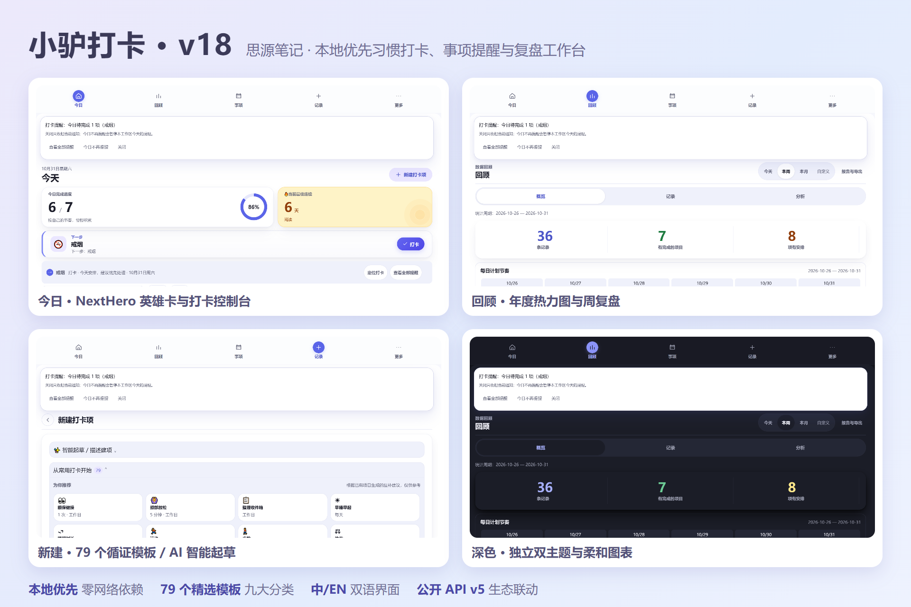

# 小驴打卡 · Lv Check-in

**专为思源笔记打造的本地优先习惯打卡、日程事项提醒与数据复盘工作台**

解决外部打卡软件锁死个人数据、笔记手写表格又无法自动统计连击与周期提醒的割裂痛点——在思源笔记内一键记录日常行动、管理农历/公历重要日期，所有数据 100% 保存在本地并可随时核对、复盘与导出。

**当前版本：18.46.1** ｜ [English Documentation](README_en.md)

> **内测说明**：小驴考试、小驴管家、小驴闪卡和小驴常用目前仍处于内测阶段，部分功能和思源宿主兼容性正在验证中。欢迎通过交流 QQ 群 **871707735** 反馈问题、提交需求；对稳定性有较高要求时，请等待对应插件发布正式版。

[⬇️ 下载安装](#-安装方式) · [🚀 快速上手](#-三步快速上手) · [🖥️ 面板指南](#-各面板用途与导航结构) · [⚙️ 设置参考](#-设置项说明默认值与影响) · [⌨️ 快捷键](#-快捷键一览) · [🔒 隐私承诺](#-数据存放与隐私说明)

 

---

## 🎯 为什么需要小驴打卡？它解决什么问题？

在个人知识管理与成长管理中，习惯打卡与日程提醒往往与笔记环境割裂，陷入“要么被外部软件绑架，要么手写表格太累”的两难境地：

| 痛点场景 | 传统外部工具 / 手写笔记局限 | 小驴打卡解决方案 |
| :--- | :--- | :--- |
| **数据主权与隐私** | 外部打卡 App 随时面临停服、改版收费、甚至个人生活习惯隐私外泄 | **100% 本地优先**：数据完全保存在思源工作空间，无外部云端，不依赖网络，随时可整体导出与备份 |
| **连击统计与视觉激励** | 笔记手写打卡表格枯燥繁琐，无法自动推算连续天数、容易断卡弃坑 | **自动化统计与正向反馈**：NextHero 英雄单卡、38px 醒目连击计数、多维年度热力图与周趋势折线图 |
| **习惯与日程事项割裂** | 习惯在打卡软件、纪念日与到期事务在日历软件，两头切换极易遗忘 | **事项与习惯同源管理**：公历/农历自动换算、倒数日、定期支出提醒，支持就地完成并一键转为长期习惯 |
| **多源自动化记录** | 微信读书、跑步运动等外部活动需要手动二次抄录入笔记 | **全生态自动化集成**：支持微信读书、iOS 健康步数/体重、思阅、思播、LifeLog 自动同步沉淀入日记 |

---

## 🌟 核心功能全景

- **🎯 五大打卡类型**：二值打卡（做/没做）、时长打卡（累计分钟/番茄钟）、计次打卡（喝水/深蹲）、数值打卡（体重/开销）、戒除与上限打卡（控糖/少玩手机）。
- **🤖 AI 自然语言智能起草（本地优先）**：在新建框输入“每天喝水 2000 毫升”、“每周读英语 3 次”，系统秒级推断打卡类型、频次与目标数值，零隐私泄露。
- **☀️ 现代化今日行动台（Today）**：NextHero 英雄单卡引领节奏、双色功能视觉分工、浅色托底+白卡漂浮微表面、早中晚时段分组，告别列表拥挤。
- **📊 深度周复盘与数据分析（Review）**：全景年度热力图、横向趋势比较、周复盘反思向导，支持一键导出结构化 Markdown 至思源日记。
- **📅 日期事项与倒数日（Occasions 2.0）**：农历公历双轨换算、生辰与纪念日倒数、单次事务就地改期，与 Task Horizon v3.3.6 大月历同源对账。
- **🐴 小驴全家桶生态联动**：深度接入小驴罗盘（Launchpad）极速弹射坞、万物穿透搜索（Omnisearch）、跨插件 IFTTT 自动化联动与今日生态活动流。

---

## 🖥️ 各面板用途与导航结构

| 面板名称 | 导航图标 | 唤起方式 | 核心定位与业务场景 |
| :--- | :---: | :---: | :--- |
| **今日 (Today)** | ☀️ | 默认主页 / `Alt+Shift+C` | 核心行动控制台：NextHero 英雄卡、进度环、待打卡清单、已完成折叠列表、专注悬浮条与今日事项横幅。 |
| **回顾 (Review)** | 📊 | 顶栏导航切换 | 数据反思与统计枢纽：概览（趋势/周复盘/分母明细）、记录（历史流水筛选、补记与撤销）与分析（横向比较/热力图/LifeLog 时间轴）。 |
| **洞察 (Insights)** | 🔍 | 单卡点击 / 导航 | 单项习惯深度体检：84 天状态日历格、每周趋势变化、习惯成熟度参考刻度与量身定制的教练建议。 |
| **事项 (Occasions)**| 📅 | 顶栏导航切换 | 日期与倒数日管理：管理年度纪念日、农历生辰与单次截止事务，支持就地完成、单次改期与一键转为长期习惯。 |
| **归档 (Archived)** | 📦 | 更多菜单 | 停用与归档项目库：查验已归档项目的历史规则、恢复排期预览、安全彻底删除或一键恢复。 |
| **设置 (Settings)** | ⚙️ | 顶栏右侧齿轮 | 系统偏好与联动中枢：外观模式、提醒时刻、外部来源绑定、思源文档输出与多桶数据备份隔离。 |

---

## 🚀 三步快速上手

1. **第一步：创建第一个打卡习惯**：点击顶栏图标或按 `Alt + Shift + C` 打开，点击「+ 新建项目」，输入 `每天喝水 2000 毫升`，点击「智能推断」后点击「保存项目」；
2. **第二步：今日行动台一键打卡**：在「今日」面板点击卡片上的快捷增量 `+250ml` 或主打卡按钮，即刻点亮进度条；
3. **第三步：在回顾页查看连击与热力图**：切换到「回顾」面板，在「概览」核对连续打卡天数，在「分析」查看年度热力图方格。

---

## 📦 安装方式

### 方式一：思源笔记官方集市安装（推荐）
1. 打开思源笔记，进入「设置」 -> 「集市」 -> 「插件」；
2. 搜索框中输入 **小驴打卡**（或 `siyuan-checkin`）；
3. 点击「下载」并「启用」，顶栏即可看到小驴打卡图标。

### 方式二：手动离线安装
1. 前往 [Releases](https://github.com/xiaolv-suite/siyuan-checkin/releases) 页面下载最新版 `package.zip`；
2. 将压缩包解压至思源工作空间的 `data/plugins/siyuan-checkin` 目录；
3. 重启思源笔记，在「设置」 -> 「插件」中启用即可。

---

## ⚙️ 设置项说明（默认值与影响）

小驴打卡提供精细的系统偏好设置，所有配置均实时保存在本地配置文件中：

| 设置分区 | 配置项名称 | 配置键 / 选项 | 默认值 | 推荐与影响说明 |
| :--- | :--- | :--- | :---: | :--- |
| **外观与操作** | 主题风格选择 | 跟随思源/浅色/深色 | `跟随思源` | 深度融入思源主题生态；暗黑模式全面对齐夜间柔和度 |
| **外观与操作** | 弹窗展示形态 | 弹窗尺寸 / 独立页签 | `快速弹窗` | 可调整弹窗尺寸或以思源独立页签形式常驻，调色板风格可选紫罗兰/海洋/森林/晚霞 |
| **动效与性能** | 动效降级开关 | 减少动效 | `关闭` | 低配设备或墨水屏可开启减少动效，消除卡片翻折与流体缩放过渡 |
| **偏好治理** | 界面状态重置 | 显示偏好重置 | `点击重置` | 误操作导致界面列宽或折叠异常时，一键恢复默认显示偏好重置 |
| **提醒调度** | 每日打卡提醒 | `dailyReminderEnabled` | `开启` | 启动时检查今日待办与事项，提醒时刻槽支持安静时段（默认 22:00~07:00 不打扰） |
| **外部自动化** | 微信读书联动 | `weread.enabled` | `关闭` | 开启后自动将每日微信读书阅读时长（默认 30 分钟阈值）计入对应打卡项 |
| **外部自动化** | 健康数据收件箱 | 无插件内配置项 | — | 由 iOS 快捷指令或 Quartz/Quicker 动作把步数与体重写入指定收件箱文档；插件不直接访问 HealthKit，也不存在 `healthKit.enabled` 配置键 |
| **文档联动** | 日记报告写回 | `journalSyncEnabled` | `关闭` | 睡前将今日完成打卡流水与心情感悟自动写入思源每日日记块 |
| **灾备与安全** | 多桶版本备份 | `dataBackupEnvelope` | `手动/自动` | 支持生成标准 JSON 主档备份与包含全量配置的 Envelope 恢复包 |

---

## ⌨️ 快捷键一览

| 快捷键 | 功能描述 | 适用上下文 |
| :--- | :--- | :--- |
| `Alt + Shift + C` | 快速唤出 / 关闭小驴打卡主窗口 | 全局任意界面 |
| `Alt + 1` ~ `Alt + 9` | 快速完成今日列表第 1 到第 9 项打卡 | 今日面板 |
| `J` / `K` | 在今日打卡卡片列表中向下 / 向上移动焦点 | 今日面板 |
| `Enter` | 触发当前聚焦卡片的主打卡动作（中文打字选词时自动防误触） | 打卡卡片 |
| `Esc` | 退出搜索框、收起下拉候选或关闭当前浮层弹窗 | 所有弹窗与输入框 |

---

## 🔒 数据存放与隐私说明

- **本地存储位置**：`data/storage/petal/siyuan-checkin/`
  - `store.json`：核心打卡项目库与配置；
  - `occasions.json`：重要日期与倒数日事项簿；
  - `view-preferences.json`：面板列宽、排序与视图显示偏好；
  - `reminders.json`：提醒调度时间槽与安静时段规则；
  - `ai-draft-history.json`：本地 AI 智能起草规则历史。
- **零遥测承诺**：100% 开源，不含任何统计 SDK 或外部遥测追踪。除用户显式配置的公开同步接口外，绝不主动发起网络连接。
- **数据导出与搬迁**：标准格式随时可查，请参阅 [导入导出格式规范](docs/export-formats.md) 与 [数据身份与合并契约](docs/identity-and-merge.md)。

---

## ❓ 常见问题与故障排查 (FAQ)

- **Q1：打卡记录不小心点错了，可以撤销吗？**  
  **答：可以，随时可撤销。** 打卡后卡片立即显示「撤销」按钮；在回顾页记录列表点击删除图标即可物理注销并写入墓碑，连击与报表即时回退。
- **Q2：更换新电脑或重装系统后，如何恢复数据？**  
  **答：通过备份文件一键恢复。** 数据存放在 `data/storage/petal/siyuan-checkin/`。主数据通过「JSON 主档备份」迁移；全量模板与设置通过「多桶版本化备份 (Envelope)」还原。
- **Q3：外部联动（微信读书/健康/叶归）为什么没有记录？**  
  **答：请排查三项：** 1) 检查项目单位是否匹配（阅读时长需分钟，步数需步，体重需千克）；2) 确认来源开关已启用且凭据有效；3) 点击「立即拉取」或「立即读取」查看具体错误原因码。
- **Q4：AI 智能起草会把我的个人笔记或私有数据发送到云端吗？**  
  **答：绝对不会！** 默认采用本地确定性规则秒级推断，零网络请求、零费用；点击「复制提示词」也仅打包当前输入框文本，绝不外发笔记正文、历史打卡或 API Key。

---

## 🔌 兼容版本与开发测试

- **最低思源笔记版本**：`思源 v3.8.4`（全面兼容桌面端、移动端与侧栏 Dock）。
- **自动化测试链**：本地运行 `pnpm test`、`pnpm run test:ui`、`pnpm run test:v18` 与全量测试套件。
- **详细文档与路线**：详见 [UI 变更记录](docs/v4.0-ui-change-log.md)、[UI 路线归档](docs/archive/ui-product-roadmap.md)、[导入导出格式](docs/export-formats.md)、[数据身份与合并](docs/identity-and-merge.md)、[v2.0 变更记录](docs/v2.0-change-log.md)、[v2.0 迁移说明](docs/v2.0-migration-notes.md) 与 [旧版 UI 路线](docs/archive/ui-redesign-roadmap.md)。

---

## 🐴 小驴系列与交流

小驴系列插件各自独立，可按需安装和组合使用：

| 插件名称 | 一句话简介 | GitHub 仓库 |
| :--- | :--- | :--- |
| [小驴雷切](https://github.com/xiaolv-suite/siyuan-speed-switch) | 思源中的统一导航与工作上下文平台，连接页签、工作台、片段和快捷入口。 | [xiaolv-suite/siyuan-speed-switch](https://github.com/xiaolv-suite/siyuan-speed-switch) |
| [小驴打卡](https://github.com/xiaolv-suite/siyuan-checkin) | 本地优先的习惯、目标打卡与复盘工作台。 | [xiaolv-suite/siyuan-checkin](https://github.com/xiaolv-suite/siyuan-checkin) |
| [小驴人脉](https://github.com/xiaolv-suite/siyuan-contacts) | 在思源中管理联系人、人际关系、组织归属和重要日期。 | [xiaolv-suite/siyuan-contacts](https://github.com/xiaolv-suite/siyuan-contacts) |
| [小驴拾遗](https://github.com/xiaolv-suite/siyuan-glean) | 整理思源剪藏和导入文章，支持状态分拣、阅读管理与日后回顾。 | [xiaolv-suite/siyuan-glean](https://github.com/xiaolv-suite/siyuan-glean) |
| [小驴考试（内测版）](https://github.com/xiaolv-suite/siyuan-exam) | 本地题库备考工作台，支持多格式导入、刷题、模考、错题复盘与 AI 辅助。 | [xiaolv-suite/siyuan-exam](https://github.com/xiaolv-suite/siyuan-exam) |
| [小驴管家（内测版）](https://github.com/xiaolv-suite/siyuan-home) | 管理家庭与生活资料、成员档案、台账、到期提醒和事务跟进。 | [xiaolv-suite/siyuan-home](https://github.com/xiaolv-suite/siyuan-home) |
| [小驴闪卡（内测版）](https://github.com/xiaolv-suite/siyuan-lv-cards) | 思源中的知识捕获、制卡、练习与复习平台，使用内核原生 FSRS 排期。 | [xiaolv-suite/siyuan-lv-cards](https://github.com/xiaolv-suite/siyuan-lv-cards) |
| [小驴常用（内测版）](https://github.com/xiaolv-suite/xiaolv-common) | 基于思源块保存、搜索并快速调用常用语、模板、代码和链接，支持变量填充。 | [xiaolv-suite/xiaolv-common](https://github.com/xiaolv-suite/xiaolv-common) |

交流 QQ 群：**871707735**（反馈问题、提交需求、交流使用体验）。反馈问题时请附上插件版本、思源版本、操作步骤和出现问题的页面。

---

## 📝 最近更新动态

### 本次更新（18.46.1）

本次更新聚焦思源 3.8.10+ 原生特性适配、移动端与无障碍深度打磨，以及全生态可靠性契约加固：

新增：思源 3.8.10+ 原生特性适配与无障碍增强

- **原生文档树上下文菜单（Issue #21219）**：打卡文档内嵌渲染块中的锚点行与习惯行支持右键唤出思源原生文档树上下文菜单，自动缓存并按需解析笔记本归属（`showDocTreeNativeMenu`）；
- **渲染块锚点重试键盘激活**：解析超时或失败后的「点击重试」按钮补齐 Enter/Space 键盘激活，与点击路径对等。

优化：动效降级、移动端排版与无障碍体验

- **输入法合成期守卫**：罗盘弹窗键盘流在输入法合成期（IME）整体让路，ArrowUp/Down 候选导航与 Enter 确认选字不再被劫持（ECO-015 契约固化）；
- **移动端与动效调优**：底部五格导航小字标签自适应截断（消除窄屏溢出挤压）；编辑操作栏适配 iOS safe-area 底部边距；平滑滚动尊重系统 `prefers-reduced-motion` 降级；滚动监听全面 passive 降负；折叠行与能量选项补充桌面端 hover 悬停高亮。

修复：剪贴板失败静默与全生态契约护航

- **剪贴板写入防御覆盖**：全面处理剪贴板写入失败路径并提供明确用户反馈，全生态覆盖率契约测试护航；
- **双端弹窗层级治理**：动态跟随思源窗口 z-index 体系，彻底消除弹层被原生窗口覆盖或焦点失焦问题。

历史版本更新（点击展开）

### 18.46.0

【事项 2.0 / 2.1】生态重塑与小驴全家桶深度联动发布：单卡高度压缩 60% 至 126px，7 大语义分类胶囊过滤，思源文档《📅 小驴事项簿》原生复选框任务块自动维护与 Task Horizon v3.3.6 同源对账，穿透全局搜索（Omnisearch）、跨插件自动化规则（Automation）、AI 习惯韧性教练与每日日记润色，彻底根除列表滚动阻断与表单回填竞争。

### 18.45.1

宽屏与弹窗流体自适应、一键生态联动 Hub、日记自动回退零配置、消除整页闪烁与番茄钟浅色白底白字。详见 [18.45.1 发布说明](docs/releases/release-notes-18.45.1.md)。

### 18.44.0

「AI 自然语言建项全闭环、视觉感知层现代化重塑与全维数据治理」版本：上线新建页自然语言智能起草与复制提示词双降级、中文输入法选词防误触、浅色托底+纯白大圆角漂浮卡片体系、操作色与成就色两色分工，以及全景无障碍对比度收敛。详见 [18.44.0 发布说明](docs/releases/release-notes-18.44.0.md)。

### 18.43.0

外部来源迟到响应配置代际守门与写前动态复核、API v5 批量写 AbortSignal 取消支持与宿主未就绪快速失败契约、以及事件墓碑生命周期治理与级联删除规范化收口。详见 [18.43.0 发布说明](docs/releases/release-notes-18.43.0.md)。

### 18.42.0

品牌矢量图标体系、CI/CD 自动化门禁与样式可维护性核心台账核销：32×32 单色矢量图标 `iconLvCheckin` 与 256×256 高清头像、GitHub Actions 并发取消工作流，以及 SCSS 单一来源治理。详见 [18.42.0 发布说明](docs/releases/release-notes-18.42.0.md)。

### 18.18.0

「可信行动事实层与生态连接里程碑」大版本：收口 Task Horizon 合作提供端协议，消除跨时区与夏令时跨度漂移，全面落地多 root 跨表面交互隔离与表单草稿保护，统一写入幂等与隐私脱敏矩阵。详见 [18.18.0 发布说明](docs/releases/release-notes-18.18.0.md)。

---

## 📄 开源协议 (License)

[MIT License](LICENSE) · 自由使用与分享，数据永远 100% 属于你。
