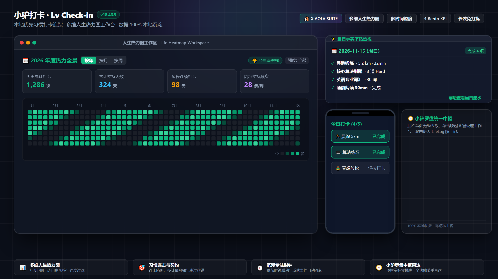

# 小驴打卡 · Lv Check-in

**专为思源笔记打造的本地优先习惯打卡、日程事项提醒与数据复盘工作台**

解决外部打卡软件锁死个人数据、笔记手写表格又无法自动统计连击与周期提醒的割裂痛点——在思源笔记内一键记录日常行动、管理农历/公历重要日期，所有数据 100% 保存在本地并可随时核对、复盘与导出。

**当前版本：18.46.6** ｜ [English Documentation](README_en.md)

> **小驴全生态矩阵**：与小驴管家、小驴人脉、小驴拾遗、小驴闪卡、小驴考试、小驴常用、小驴雷切共用统一通知中枢、AI 路由与无感灾备底座。欢迎通过交流 QQ 群 **871707735** 反馈问题或提交建议。

[⬇️ 下载安装](#-安装方式) · [🚀 快速上手](#-三步快速上手) · [🖥️ 面板指南](#-各面板用途与导航结构) · [⚙️ 设置参考](#-设置项说明默认值与影响) · [⌨️ 快捷键](#-快捷键一览) · [🔒 隐私承诺](#-数据存放与隐私说明)

 

---

## 🚀 本次更新要点（v18.46.6 · 2026-11-26 里程碑正式版）

- **全生态共享中枢与四级折叠日记区**：深度融合小驴罗盘、全生态 AI 路由、块助手 1–8 原生底座与自定义双击、活动流及联合灾备；打卡流水、微反思与总结统一安全写入 `#### 🐴 小驴记录` 四级折叠区（绝不越界污染根文档）；
- **微反思与复盘矩阵闭环**：打卡完成回执条一键唤起「💭 记微反思」弹窗并同步日记；回顾页支持历史排期月历矩阵点选补卡与一键清空草稿；
- **全场景统一 AI 等待体验 (`.lv-ai-thinking`)**：今日日记 AI 润色、AI 习惯韧性教练与回顾扩展总结全面支持阶段提示、实时计时与 `AbortSignal` 随时取消，同宿主复用且 Dock/Tab 销毁前自动中止清理；
- **双端防重复日记 P0 根治与三态安全防线**：彻底修复未开启健康收件箱时后台静默建日记的问题（后台扫描与预览严格 `create=false` 只读），对齐思源 `local-dailynoteid` 主日记本，并建立「SQL + `/api/filetree/getIDsByHPath` 实时文件树」三态 fail-closed 复核与单飞互斥锁；
- **零 `:has()` / 零高模糊 60fps 极速性能**：彻底消除 CSS `:has()` 与高模糊（`>=15px`）样式风暴，人生热力图支持年/月/周三态切换与 4 套主题色板，桌面浅/深双主题与 `390×844` 原生移动端零溢出。

展开查看历史版本更新记录（v18.46.5 及更早版本 · 完整记录见 CHANGELOG.md）

- **v18.46.5**：微反思与复盘矩阵闭环、`.lv-ai-thinking` AI 等待生命周期治理、防重复日记三态互斥与启动存储减负。

- **v18.46.4**：覆盖思源官方齿轮直达设置页、日记冲突副本双重过滤、设置页表单控件规范化与公共保活定时器降耗。
- **v18.46.3**：人生热力图工作区与多维强度筛选上线、全生态罗盘顶栏防横跳、通知折叠去重与长效免打扰固化。
- **v18.46.2**：罗盘启动防抖与顶栏对齐、LifeLog 照片流与原子多块撤销、全生态联合灾备恢复、移动端全面去电脑化。

---

## 🐴 小驴思源全家桶生态矩阵与交流

本插件为「小驴思源生态」8 大官方集市插件之一。所有插件共享小驴罗盘（顶栏常驻中枢）、全域穿透搜索与统一备份恢复：

| 插件名称 | 核心用途 | 官方集市 / 仓库 |
| :--- | :--- | :--- |
| **小驴打卡** | 本地优先习惯打卡、日程提醒与多维人生热力图工作台 | [`siyuan-checkin`](https://github.com/xiaolv-suite/siyuan-checkin) |
| **小驴管家** | 家庭成员中心视角档案、证照保单到期预警与 LifeLog 流水协同 | [`siyuan-home`](https://github.com/xiaolv-suite/siyuan-home) |
| **小驴人脉** | 一人一文档人际管理、圈层力导向关系网络与会前破冰速览 | [`siyuan-contacts`](https://github.com/xiaolv-suite/siyuan-contacts) |
| **小驴拾遗** | 剪藏文章深度消化、视线同焦伴生导读与 4 大学术著录 | [`siyuan-glean`](https://github.com/xiaolv-suite/siyuan-glean) |
| **小驴闪卡** | 原生 FSRS 算法调度、文档内质感序号流与全场景极速制卡 | [`siyuan-lv-cards`](https://github.com/xiaolv-suite/siyuan-lv-cards) |
| **小驴考试** | 全真模拟考场环境、错题靶向归因复训与苏格拉底启发式 AI 导师 | [`siyuan-exam`](https://github.com/xiaolv-suite/siyuan-exam) |
| **小驴常用** | 代码片段工作室、零卡死安全剪贴板历史与一键记事沙盒 | [`xiaolv-common`](https://github.com/xiaolv-suite/xiaolv-common) |
| **小驴雷切** | 毫秒级多文档穿透切换、左右双文档实时分栏对照与切片代码画板 | [`siyuan-speed-switch`](https://github.com/xiaolv-suite/siyuan-speed-switch) |

💬 **官方交流与需求反馈 QQ 群**：**871707735**（开发者实时在线，欢迎反馈问题、交流使用体验与提交新功能构想）。

---

## 🎯 为什么需要小驴打卡？它解决什么问题？

在个人知识管理与成长管理中，习惯打卡与日程提醒往往与笔记环境割裂，陷入“要么被外部软件绑架，要么手写表格太累”的两难境地：

| 痛点场景 | 传统外部工具 / 手写笔记局限 | 小驴打卡解决方案 |
| :--- | :--- | :--- |
| **数据主权与隐私** | 外部打卡 App 随时面临停服、改版收费、甚至个人生活习惯隐私外泄 | **100% 本地优先**：数据完全保存在思源工作空间，无外部云端，不依赖网络，随时可整体导出与备份 |
| **连击统计与视觉激励** | 笔记手写打卡表格枯燥繁琐，无法自动推算连续天数、容易断卡弃坑 | **自动化统计与正向反馈**：NextHero 英雄单卡、38px 醒目连击计数、多维年度热力图与周趋势折线图 |
| **习惯与日程事项割裂** | 习惯在打卡软件、纪念日与到期事务在日历软件，两头切换极易遗忘 | **事项与习惯同源管理**：公历/农历自动换算、倒数日、定期支出提醒，支持就地完成并一键转为长期习惯 |
| **多源自动化记录** | 微信读书、跑步运动等外部活动需要手动二次抄录入笔记 | **全生态自动化集成**：支持微信读书、iOS 健康步数/体重、思阅、思播、LifeLog 自动同步沉淀入日记 |

---

## 🌟 核心功能全景

- **🎯 五大打卡类型**：二值打卡（做/没做）、时长打卡（累计分钟/番茄钟）、计次打卡（喝水/深蹲）、数值打卡（体重/开销）、戒除与上限打卡（控糖/少玩手机）。
- **🤖 AI 自然语言智能起草（本地优先）**：在新建框输入“每天喝水 2000 毫升”、“每周读英语 3 次”，系统秒级推断打卡类型、频次与目标数值，零隐私泄露。
- **☀️ 现代化今日行动台（Today）**：NextHero 英雄单卡引领节奏、双色功能视觉分工、浅色托底+白卡漂浮微表面、早中晚时段分组，告别列表拥挤。
- **📊 深度周复盘与数据分析（Review）**：全景年度热力图、横向趋势比较、周复盘反思向导，支持一键导出结构化 Markdown 至思源日记。
- **📅 日期事项与倒数日（Occasions 2.0）**：农历公历双轨换算、生辰与纪念日倒数、单次事务就地改期，与 Task Horizon v3.3.6 大月历同源对账。
- **🐴 小驴全家桶生态联动**：深度接入小驴罗盘（Launchpad）极速弹射坞、万物穿透搜索（Omnisearch）、跨插件 IFTTT 自动化联动与今日生态活动流。

---

## 🖥️ 各面板用途与导航结构

| 面板名称 | 导航图标 | 唤起方式 | 核心定位与业务场景 |
| :--- | :---: | :---: | :--- |
| **今日 (Today)** | ☀️ | 默认主页 / `Alt+Shift+C` | 核心行动控制台：NextHero 英雄卡、进度环、待打卡清单、已完成折叠列表、专注悬浮条与今日事项横幅。 |
| **回顾 (Review)** | 📊 | 顶栏导航切换 | 数据反思与统计枢纽：概览（趋势/周复盘/分母明细）、记录（历史流水筛选、补记与撤销）与分析（横向比较/热力图/LifeLog 时间轴）。 |
| **洞察 (Insights)** | 🔍 | 单卡点击 / 导航 | 单项习惯深度体检：84 天状态日历格、每周趋势变化、习惯成熟度参考刻度与量身定制的教练建议。 |
| **事项 (Occasions)**| 📅 | 顶栏导航切换 | 日期与倒数日管理：管理年度纪念日、农历生辰与单次截止事务，支持就地完成、单次改期与一键转为长期习惯。 |
| **归档 (Archived)** | 📦 | 更多菜单 | 停用与归档项目库：查验已归档项目的历史规则、恢复排期预览、安全彻底删除或一键恢复。 |
| **设置 (Settings)** | ⚙️ | 顶栏右侧齿轮 | 系统偏好与联动中枢：外观模式、提醒时刻、外部来源绑定、思源文档输出与多桶数据备份隔离。 |

---

## 🚀 三步快速上手

1. **第一步：创建第一个打卡习惯**：点击顶栏图标或按 `Alt + Shift + C` 打开，点击「+ 新建项目」，输入 `每天喝水 2000 毫升`，点击「智能推断」后点击「保存项目」；
2. **第二步：今日行动台一键打卡**：在「今日」面板点击卡片上的快捷增量 `+250ml` 或主打卡按钮，即刻点亮进度条；
3. **第三步：在回顾页查看连击与热力图**：切换到「回顾」面板，在「概览」核对连续打卡天数，在「分析」查看年度热力图方格。

---

## 📦 安装方式

### 方式一：思源笔记官方集市安装（推荐）
1. 打开思源笔记，进入「设置」 -> 「集市」 -> 「插件」；
2. 搜索框中输入 **小驴打卡**（或 `siyuan-checkin`）；
3. 点击「下载」并「启用」，顶栏即可看到小驴打卡图标。

### 方式二：手动离线安装
1. 前往 [Releases](https://github.com/xiaolv-suite/siyuan-checkin/releases) 页面下载最新版 `package.zip`；
2. 将压缩包解压至思源工作空间的 `data/plugins/siyuan-checkin` 目录；
3. 重启思源笔记，在「设置」 -> 「插件」中启用即可。

---

## ⚙️ 设置项说明（默认值与影响）

小驴打卡提供精细的系统偏好设置，所有配置均实时保存在本地配置文件中：

| 设置分区 | 配置项名称 | 配置键 / 选项 | 默认值 | 推荐与影响说明 |
| :--- | :--- | :--- | :---: | :--- |
| **外观与操作** | 主题风格选择 | 跟随思源/浅色/深色 | `跟随思源` | 深度融入思源主题生态；暗黑模式全面对齐夜间柔和度 |
| **外观与操作** | 弹窗展示形态 | 弹窗尺寸 / 独立页签 | `快速弹窗` | 可调整弹窗尺寸或以思源独立页签形式常驻，调色板风格可选紫罗兰/海洋/森林/晚霞 |
| **动效与性能** | 动效降级开关 | 减少动效 | `关闭` | 低配设备或墨水屏可开启减少动效，消除卡片翻折与流体缩放过渡 |
| **偏好治理** | 界面状态重置 | 显示偏好重置 | `点击重置` | 误操作导致界面列宽或折叠异常时，一键恢复默认显示偏好重置 |
| **提醒调度** | 每日打卡提醒 | `dailyReminderEnabled` | `开启` | 启动时检查今日待办与事项，提醒时刻槽支持安静时段（默认 22:00~07:00 不打扰） |
| **外部自动化** | 微信读书联动 | `weread.enabled` | `关闭` | 开启后自动将每日微信读书阅读时长（默认 30 分钟阈值）计入对应打卡项 |
| **外部自动化** | 健康数据收件箱 | 无插件内配置项 | — | 由 iOS 快捷指令或 Quartz/Quicker 动作把步数与体重写入指定收件箱文档；插件不直接访问 HealthKit，也不存在 `healthKit.enabled` 配置键 |
| **文档联动** | 日记报告写回 | `journalSyncEnabled` | `关闭` | 睡前将今日完成打卡流水与心情感悟自动写入思源每日日记块 |
| **灾备与安全** | 多桶版本备份 | `dataBackupEnvelope` | `手动/自动` | 支持生成标准 JSON 主档备份与包含全量配置的 Envelope 恢复包 |

---

## ⌨️ 快捷键一览

| 快捷键 | 功能描述 | 适用上下文 |
| :--- | :--- | :--- |
| `Alt + Shift + C` | 快速唤出 / 关闭小驴打卡主窗口 | 全局任意界面 |
| `Alt + 1` ~ `Alt + 9` | 快速完成今日列表第 1 到第 9 项打卡 | 今日面板 |
| `J` / `K` | 在今日打卡卡片列表中向下 / 向上移动焦点 | 今日面板 |
| `Enter` | 触发当前聚焦卡片的主打卡动作（中文打字选词时自动防误触） | 打卡卡片 |
| `Esc` | 退出搜索框、收起下拉候选或关闭当前浮层弹窗 | 所有弹窗与输入框 |

---

## 🔒 数据存放与隐私说明

- **本地存储位置**：`data/storage/petal/siyuan-checkin/`
  - `store.json`：核心打卡项目库与配置；
  - `occasions.json`：重要日期与倒数日事项簿；
  - `view-preferences.json`：面板列宽、排序与视图显示偏好；
  - `reminders.json`：提醒调度时间槽与安静时段规则；
  - `ai-draft-history.json`：本地 AI 智能起草规则历史。
- **零遥测承诺**：100% 开源，不含任何统计 SDK 或外部遥测追踪。除用户显式配置的公开同步接口外，绝不主动发起网络连接。
- **数据导出与搬迁**：标准格式随时可查，请参阅 [导入导出格式规范](docs/export-formats.md) 与 [数据身份与合并契约](docs/identity-and-merge.md)。

---

## ❓ 常见问题与故障排查 (FAQ)

- **Q1：打卡记录不小心点错了，可以撤销吗？**  
  **答：可以，随时可撤销。** 打卡后卡片立即显示「撤销」按钮；在回顾页记录列表点击删除图标即可物理注销并写入墓碑，连击与报表即时回退。
- **Q2：更换新电脑或重装系统后，如何恢复数据？**  
  **答：通过备份文件一键恢复。** 数据存放在 `data/storage/petal/siyuan-checkin/`。主数据通过「JSON 主档备份」迁移；全量模板与设置通过「多桶版本化备份 (Envelope)」还原。
- **Q3：外部联动（微信读书/健康/叶归）为什么没有记录？**  
  **答：请排查三项：** 1) 检查项目单位是否匹配（阅读时长需分钟，步数需步，体重需千克）；2) 确认来源开关已启用且凭据有效；3) 点击「立即拉取」或「立即读取」查看具体错误原因码。
- **Q4：AI 智能起草会把我的个人笔记或私有数据发送到云端吗？**  
  **答：绝对不会！** 默认采用本地确定性规则秒级推断，零网络请求、零费用；点击「复制提示词」也仅打包当前输入框文本，绝不外发笔记正文、历史打卡或 API Key。

---

## 🔌 兼容版本与开发测试

- **最低思源笔记版本**：`思源 v3.8.4`（全面兼容桌面端、移动端与侧栏 Dock）。
- **自动化测试链**：本地运行 `pnpm test`、`pnpm run test:ui`、`pnpm run test:v18` 与全量测试套件。
- **详细文档与路线**：详见 [完整更新日志](CHANGELOG.md)、[v18.46.6 变更详情](docs/v18.46.6-change-log.md)、[UI 变更记录](docs/v4.0-ui-change-log.md)、[UI 路线归档](docs/archive/ui-product-roadmap.md)、[导入导出格式](docs/export-formats.md)、[数据身份与合并](docs/identity-and-merge.md)、[v2.0 变更记录](docs/v2.0-change-log.md)、[v2.0 迁移说明](docs/v2.0-migration-notes.md) 与 [旧版 UI 路线](docs/archive/ui-redesign-roadmap.md)。

---

## 📄 开源协议 (License)

[MIT License](LICENSE) · 自由使用与分享，数据永远 100% 属于你。
