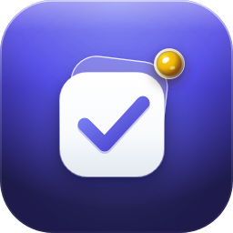

# Lv Check-in

**A Local-First Habit, Check-in & Review Workspace for SiYuan**

Record your actions once, then track, review, and correlate them with your notes—all with verifiable, local-first data.

**Current Version: 18.43.0**

18.43.0 delivers generation guards for late external source responses, AI draft governance with dual offline fallbacks, unachieved reflection matrix, and systemic quality and performance tuning.

 

[Latest Release](https://github.com/ai68298100/siyuan-checkin/releases/latest) · [Documentation](docs/README.md) · [Issue Tracker](https://github.com/ai68298100/siyuan-checkin/issues)

### What's New in 18.43.0

- **External Source Generation Guards & Pre-flight Validation (T-1684)**: Comprehensive session and configuration generation guards for WeChat Read, YeGui LifeLog, Health, Note Ingestion, SiPlayer, and SiReader to prevent late responses from writing to stale targets.
- **Natural Language Draft Governance & Safe AI Integration (T-1686 ~ T-1690)**: Host model readiness checks before dispatch; self-contained prompt builder and deterministic offline rule generator for graceful degradation; XSS injection shielding and manual user form field protection.
- **Calm UX Unachieved Reflection Matrix (T-1634)**: Four-state orthogonal model (Done, Skip, Unachieved, Unrecorded) with supportive non-judgmental wording; freeze streaks on Skip and capture optional reflections on missed opportunities.
- **Systemic Quality & Performance Optimization**: Eliminated global `window` listener leaks in audio samplers; optimized DOM querying and icon tree traversal; cut item list rendering time by ~36% (median 14ms); unified ARIA controls for screen readers.

Legacy Release Highlights (Click to expand)

### 18.42.0
Monochrome vector icon system (32x32), automated CI/CD workflows with concurrency cancellation, and structural SCSS refactoring under 680 KiB budget with 0 dead classes.

### 18.18.0
Action facts layer milestone, Task Horizon cooperative provider protocols, cross-surface multi-root isolation, and unified write idempotency.

## Key Features

- **Local-First & Zero Telemetry**: All check-in events, item rules, and preferences are stored exclusively on your device via SiYuan's storage API. No external cloud sync or accounts required.
- **Flexible Habit Types**: Supports Binary completion, Count, Duration (minutes/hours), Custom Measurement Units, and Abstinence/At-Most goals.
- **Review & Bento Insights**: Day, Week, Month, and Custom range summaries, 4-theme yearly heatmaps, Sigmoid habit saturation curves, and energy flow cross-analysis.
- **Seamless Note Integration**: Append check-ins to daily notes in standard LifeLog format, bidirectional block deletion on undo, and automatic SiYuan 3.8.8+ Database Block Collection attributes.
- **Ecosystem Federation**: Out-of-the-box integration with Task Horizon, WeChat Read, SiReader, SiPlayer, Health Shortcuts, and Raikiri modules.

## Public API & Ecosystem Federation

The plugin provides `window.siyuanCheckin` under protocol `siyuan-checkin` (API version 5):
- Capabilities: `items.query`, `events.range.read`, `events.record.batch`, `metrics.read`, `diagnostics.read`, `calendar.read`, and more.
- Supports `AbortSignal` cancellation for both batch recording and range reading.
- Fail-fast lifecycle contracts when storage is not ready or during plugin teardown.
- Strict anti-spoofing enforcement: external write requests are sanitized to `source: "api"`.
- Defensive copies and automated diagnostic redaction protect sensitive tokens and local paths.

## Installation & Compatibility

- **Minimum Required SiYuan Version**: `v3.8.4` (verified on `v3.8.8+`).
- **Platforms**: Desktop (Windows, macOS, Linux), Mobile (Android, iOS), Browser WebViews.

### From SiYuan Bazaar
1. Open SiYuan **Settings → Bazaar → Plugins**.
2. Search for `小驴打卡` or `Lv Check-in` and click **Download & Install**.
3. Reload or enable the plugin from top bar or command palette.

## 30-Second Quick Start

1. Go to **New** tab, select a built-in template or enter habit name, type, target, and schedule.
2. Click **Save** and return to **Today**. Click the habit card to check in immediately, or use quick-step increments.
3. Switch to **Review** tab to view your daily streaks, calendar rhythms, and multi-dimensional analysis.

## Available Surfaces

- **Desktop Tab**: Open via Command Palette `Open Lv Check-in Tab` or configure as default view in Settings.
- **Dock Panel**: Accessible from left/bottom dock for quick side-by-side check-ins.
- **Quick Dialog**: Lightweight popup for distraction-free check-ins without leaving your current note.
- **Mobile Optimized**: Single-column responsive layout, touch-friendly 44px targets, safe area protection, and haptic feedback.

## Data Safety & Privacy

- Core check-ins and review features run 100% locally with zero cloud dependencies.
- Export options include JSON Master Backup, Multi-Bucket BackupEnvelope (v1), RFC 4180 CSV, Markdown Reports, Loop Habit Tracker, and Obsidian Habit Tracker 21.
- Sensitive fields (notes, photos, tokens) are audited before export, and diagnostic details are automatically redacted.

## License

[MIT](LICENSE)
